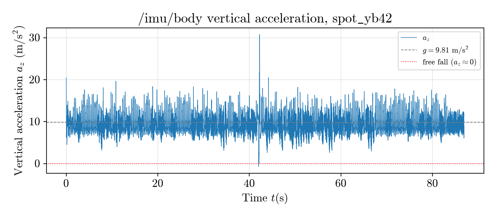
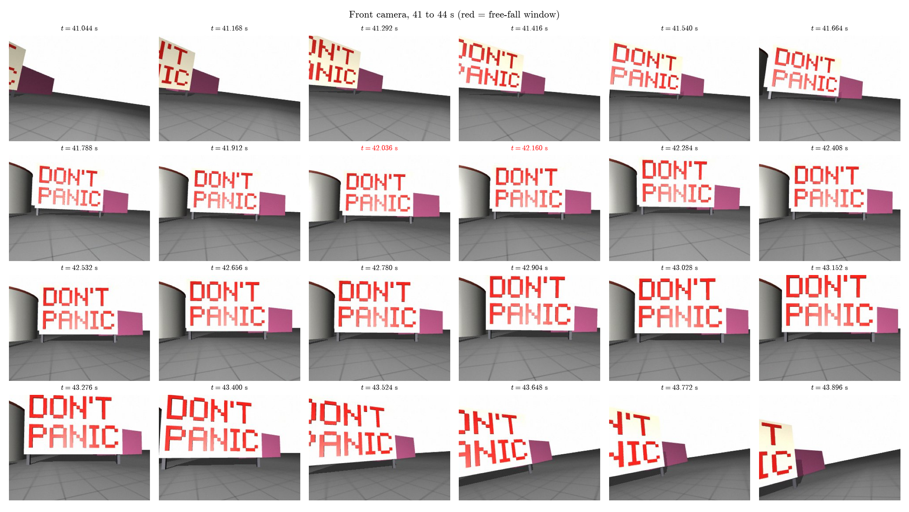
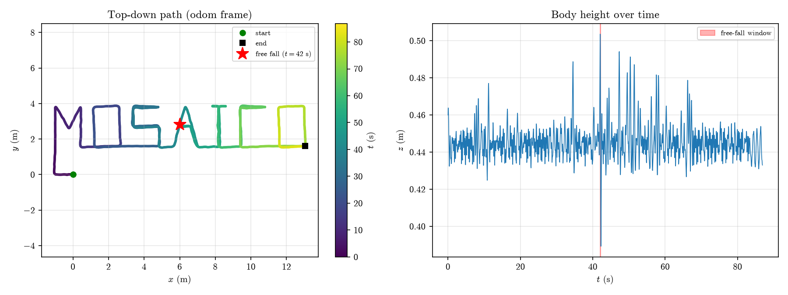

# Mosaico Challenge, Mission YB-42

Last night the Boston Dynamics Spot robot `spot-07` patrolled Yard B, and the night-shift operator swears nothing happened. The challenge (see [CHALLENGE.md](CHALLENGE.md)) is to ingest the 87 s ROS 2 recording into the [Mosaico](https://mosaico.dev) data platform and use a **single Mosaico query** to find the moment the robot was in free fall, which is when its IMU measured almost no vertical acceleration. The bonus is to look at what the robot saw and where it walked.

## Result

Something did happen. At **42.000 s** into the bag, `spot-07` was in free fall for **124 ms**. Free fall for 124 ms corresponds to a drop of roughly **7.5 cm** (d = ½·g·t² = ½ · 9.81 · 0.124² ≈ 0.075 m).

| | |
|---|---|
| Free-fall start (UTC, ns) | `1795181862000000000` (2026-11-20 13:37:42.000 UTC) |
| Free-fall end (UTC, ns) | `1795181862124000000` |
| Duration | 124 ms |
| Bag start (UTC, ns) | `1795181820000000000` |

### Query

```python
Query(
    QuerySequence().with_user_metadata("robot", eq="spot-07"),
    QueryTopic().with_name("/imu/body"),
    QueryOntologyCatalog().with_expression(
        IMU.Q.acceleration.z.lt(0.1)
    ),
)
```

The query restricts the search to sequences whose metadata says `robot = spot-07`, then to the `/imu/body` topic, and keeps only IMU samples with vertical acceleration below 0.1 m/s². The matches are grouped with `clusterize(clustering_dt_ns=100_000_000)` so that gaps longer than 100 ms start a new window. Exactly one window comes back.

### Figures

Vertical acceleration from the body IMU sits around g for the whole patrol, except for one dip to zero at 42 s.



The front camera from 41 s to 44 s, with the frames during and just after the free-fall window titled in red.



The odometry path seen from above with the free-fall location marked, and the body height over time.



A 15 s annotated clip of the front camera around the fall is in [results/spot07_fall_15s.mp4](results/spot07_fall_15s.mp4).

## Repository layout

```
CHALLENGE.md                         challenge brief
data/sequence_metadata.json          sequence metadata used at ingestion
data/spot_yb42.mcap                  the ROS 2 bag
scripts/config.py                    shared constants and paths
scripts/freefall.py                  the free-fall query, reused by every script
scripts/01_query_free_fall.py        runs the query and prints the window
scripts/02_plot_imu.py               IMU vertical acceleration plot
scripts/03_camera_and_trajectory.py  camera contact sheet and trajectory plots
scripts/04_make_video.py             15 s annotated video of the fall
results/                             final figures and video
build/                               intermediate frames (gitignored)
```

Every script resolves paths from the repo root, so they can be run from any directory. Scripts 03 and 04 get the free-fall timestamps by running the same query as script 01, and they read the bag start time from the sequence itself, so nothing is hardcoded.

## Setup from zero (Ubuntu or WSL2)

### Prerequisites

- Python 3.10 or newer
- Docker (the Mosaico installer runs the server and its database in containers). On WSL2 either install Docker Engine inside the distro or enable WSL integration in Docker Desktop.
- ffmpeg, used by the video script
- python3-venv to create the virtual environment
- python3-tk, which is optional and only needed for interactive plot windows

```bash
sudo apt update
sudo apt install -y git python3 python3-venv python3-tk ffmpeg
```

### Clone and create the virtual environment

```bash
git clone https://github.com/Omair-S/mosaico_challenge.git
cd mosaico_challenge
python3 -m venv .venv
source .venv/bin/activate
pip install -r requirements.txt
```

Activate the venv with `source .venv/bin/activate` in every new terminal before running anything below.

### Get the dataset

The recording `data/spot_yb42.mcap` (about 13 MB) and its metadata `data/sequence_metadata.json` are included in the repository, so cloning is enough.

### Install and start the Mosaico server

```bash
curl -fsSL https://get.mosaico.dev | sh
```

The installer asks a few questions. These are the answers used for this project.

- Database. Use the embedded PostgreSQL container.
- Storage. Use the local filesystem.
- Master API key. Do not set one.
- Cleanup routine. Keep the default.

Once it finishes, the server listens on `localhost:6726`. Check that it is up with either of these.

```bash
ss -ltn | grep 6726
nc -zv localhost 6726
```

A line containing `127.0.0.1:6726` (or `succeeded` from `nc`) means the server is ready.

### Ingest the bag

From the repo root, with the venv active.

```bash
mosaicolabs.ros_injector data/spot_yb42.mcap --name spot_yb42 --metadata data/sequence_metadata.json
```

This creates the sequence `spot_yb42` with the metadata `robot = spot-07`, which the query filters on. Add `--host` or `--port` if your server is not on `localhost:6726`, and add `--update-if-exists` if the sequence already exists. Run `mosaicolabs.ros_injector --help` for all options.

## Running the scripts

Run them in order from the repo root (any directory works, but this keeps the commands short).

```bash
python scripts/01_query_free_fall.py
python scripts/02_plot_imu.py
python scripts/03_camera_and_trajectory.py
python scripts/04_make_video.py
```

| Script | What it does | Output |
|---|---|---|
| `01_query_free_fall.py` | Runs the single Mosaico query and prints each free-fall window with its length | Terminal output only, one window from `1795181862000000000` to `1795181862124000000`, 124.0 ms |
| `02_plot_imu.py` | Streams all of `/imu/body`, lists every sample below 0.1 m/s² (32 of them) and plots a_z over time | `results/imu_z.png` |
| `03_camera_and_trajectory.py` | Saves the front camera frames from 1 s before to 2 s after the fall and reads the full odometry | `results/camera_contact_sheet.png`, `results/trajectory.png`, and 24 frames in `build/frames/` |
| `04_make_video.py` | Annotates 15 s of camera frames (11 s before, 4 s after the fall) with a countdown, a FREE FALL banner and a LANDED banner, then encodes them with ffmpeg at 8 fps | `results/spot07_fall_15s.mp4`, and 121 frames in `build/video_frames/` |

Scripts 02 and 03 also open interactive plot windows when Tk is available. Close the window to let the script exit. To skip the windows entirely, run with `MPLBACKEND=Agg`, for example `MPLBACKEND=Agg python scripts/02_plot_imu.py`.

Shared settings such as the host, port, sequence name, topic names and the 0.1 m/s² threshold live in `scripts/config.py`.

## Troubleshooting

**`error: externally-managed-environment` from pip.** The system Python on recent Ubuntu refuses global installs. Activate the venv with `source .venv/bin/activate` and run `pip install -r requirements.txt` again. If `python3 -m venv` itself fails, install `python3-venv` with apt.

**`Connection refused` on port 6726.** The Mosaico server is not running. Check that Docker is running (`docker ps`) and that the Mosaico containers are up, then confirm with `ss -ltn | grep 6726`. On WSL2 make sure Docker Desktop's WSL integration is enabled for your distro, or that the Docker service is started inside it.

**Query returns no matches, or the script says the sequence does not exist.** The bag has not been ingested yet, or it was ingested under a different name. Run the `ros_injector` command above with `--name spot_yb42` and the metadata file.

**No plot window appears in WSL.** Matplotlib needs Tk to open windows. Install it with `sudo apt install python3-tk`, and on older WSL setups without WSLg you also need an X server. The figures are saved to `results/` regardless, so you can open the PNGs directly instead.

**`FileNotFoundError: 'ffmpeg'` from script 04.** Install ffmpeg with `sudo apt install ffmpeg`.
